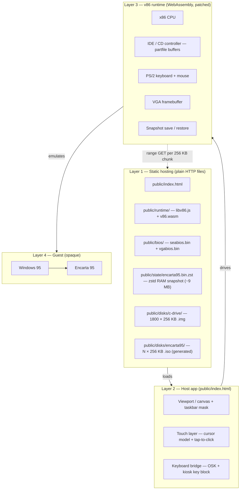
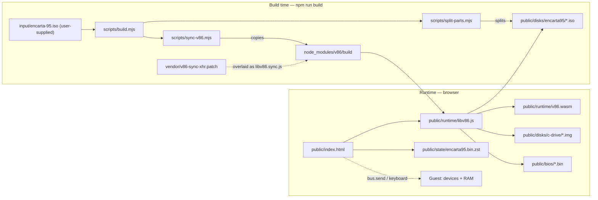

# Architecture

How the pieces fit together. The short version: this is a **full PC emulated in WebAssembly**
running Windows 95 and Encarta 95, wrapped in a thin host UI that keeps the **initial download
small** by streaming the disks on demand.

## Key ideas

- **Two state machines.** The guest (Windows 95 + Encarta) is an opaque VM. The host is a small
  web page that can touch it only through a few narrow interfaces: **video** (framebuffer → canvas),
  **input** (synthesized PS/2 events), **disk** (serving bytes to the emulated IDE/CD controller),
  and **RAM** (snapshot save/restore).
- **Small initial download**, achieved by three separations: runtime vs data; a **RAM-only
  snapshot (~64 MB)** vs the **disks** (HD ~471 MB, CD ~675 MB); and disks **split into 256 KB
  parts fetched on demand**.
- **Synchronous paged I/O.** Reads are made synchronous (`synchronous: true`, via a patched v86
  build) because Windows 95's `ESDI_506` driver aborts asynchronous CD reads — this is what keeps
  CD-backed features stable.
- **Touch and keyboard are host-side layers** that synthesize PS/2 input; the guest is unaware.

## Layers of the system

Each layer is a container; arrows show the direction of control/data dependency, and the dashed
edge is the on-demand paging.

## Article deep links

The host exposes hash routes (`#/article/<title>`) without changing the guest:

- `ENCTITLE.EXE` (baked into the Windows disk and autostarted from `win.ini`; source in
  `spike/enctitle16.c`) calls Encarta's `ENCARAPI.FGETCURTOPICTITLE` through a 16-bit helper and
  streams `T<title>` lines over COM1. This also covers articles with no media caption (for
  example `Anorexia Nervosa` and `Piracy`).
- `public/title-map.js` is generated from `ENCYC95/ENCARTA.M12`. It maps media captions to
  canonical Pinpointer/article titles and includes a canonical-title set used to avoid
  remapping searchable titles.
- URL-driven navigation pins the requested title until the caption changes. Ambiguous captions
  (the same caption reused by multiple articles) fall back to the caption when browsing manually.

## Dependency graph

What depends on what, split into build time and runtime.

